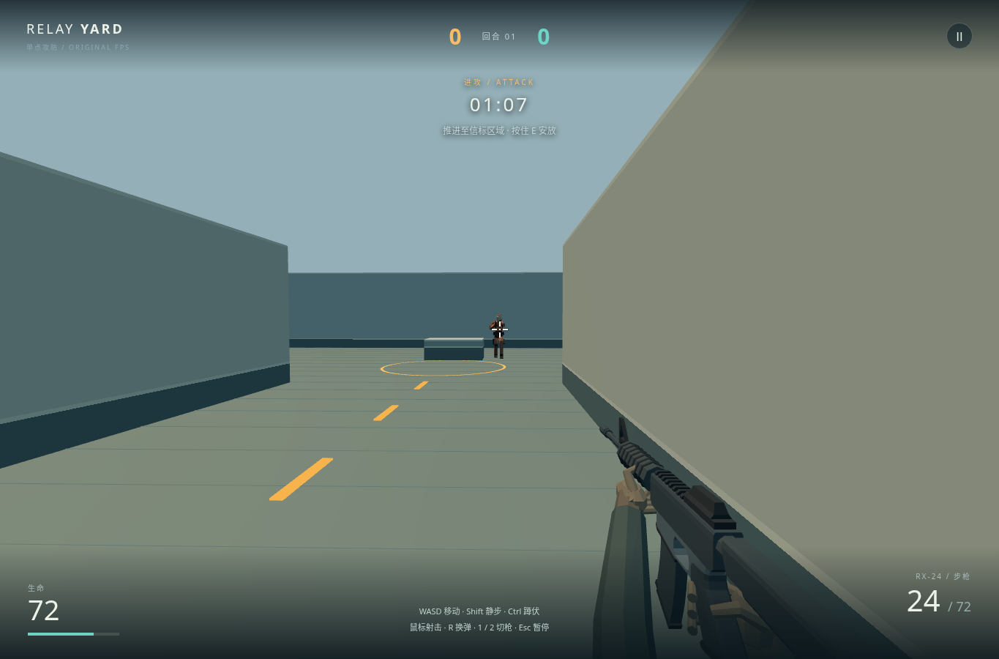
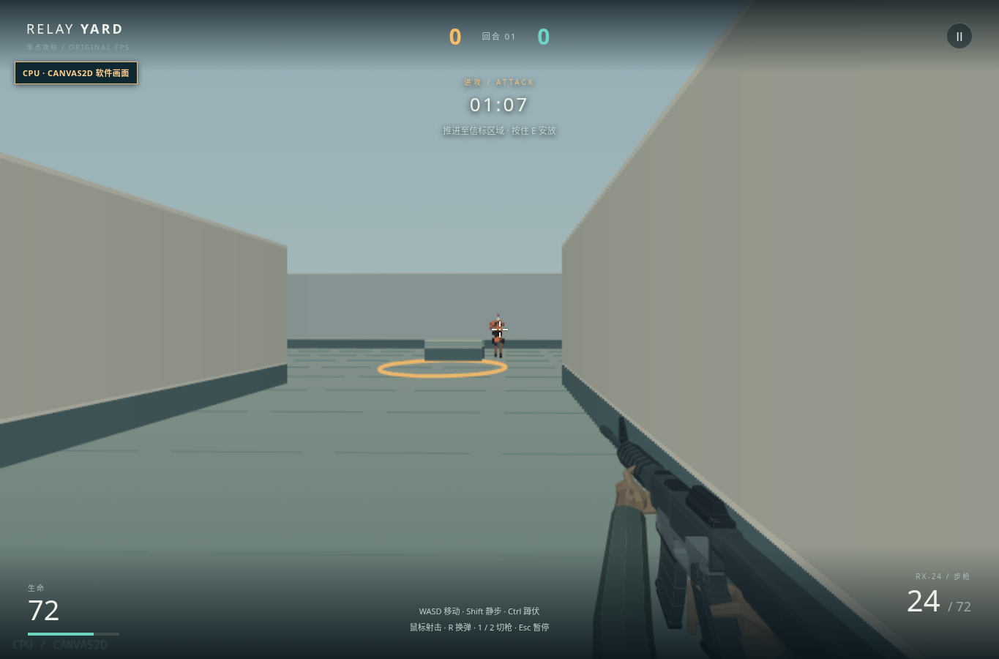

# 当前品质：中路目标的头部识别

**浅砂色头盔让头顶从背景中更容易分离，胸口碎色问题仍未解决。** 本轮只调整同源角色的材料色族，保持形体、头胸命中体、遮挡、AI 与射击规则；当前仍未达到 CS2 基本射击循环品质。

## 当前画面

Three.js 软件 WebGL2，正常键鼠输入中的中路探出。

两图来自 2026-10-26 的运行代码 `85524a4`。Canvas2D CPU 使用同一几何与色族，仍是独立验证的简化画面，不代表硬件 GPU 品质。

## 参照与差距

主参照为 [Valve 的 CS2 商店页](https://store.steampowered.com/app/730/CounterStrike_2/)及其[官方持枪角色展示图](https://shared.akamai.steamstatic.com/store_item_assets/steam/apps/730/4ef95eed5fcd98c576bf13e024bc6c845b622132/ss_4ef95eed5fcd98c576bf13e024bc6c845b622132.1920x1080.jpg)：比较头、躯干与装备的明暗分组和持枪轮廓。2026-10-26 取回；展示图不是同距离战斗，也不代表本轮实际玩过当前 CS2。与本作 v6 的并排图只留本地。

| 维度 | 当前结果与最大差距 |
|---|---|
| 头部识别 | 浅头盔在 Three 暗墙前的分离最明确；远头仍小，未测发现率或反应时间。 |
| 躯干识别 | 没有洗白整个人物，枪、深布与肢体间隙保留；胸板改善很弱，中央仍被枪与深布切碎，不能称胸部问题已解决。 |
| 形体与动作 | 已有肩肘、腰腿与胸前持枪轮廓保留；仍是固定源姿态，移动滑移、整身倒下与硬直的第一人称腕臂未改善。 |
| 场景与界面 | 墙脚、低掩体边界与亮地面仍可读；场景材质层次弱，亮天上的顶部小字对比不足。 |
| 完整射击循环 | 连续受击姿态、手指接触自然度与声音层次仍欠缺；本轮没有实际听音，不能据静帧判断动作自然。 |

正常接敌、命中和倒下静帧经非作者复评，接收为小幅头部可读性增量。新旧正常输入的探出点略有差异，不把命中数当准确率对照。人物来源及双后端材料配方见 [Relay Guard](../assets/characters/relay-guard/README.md)。
