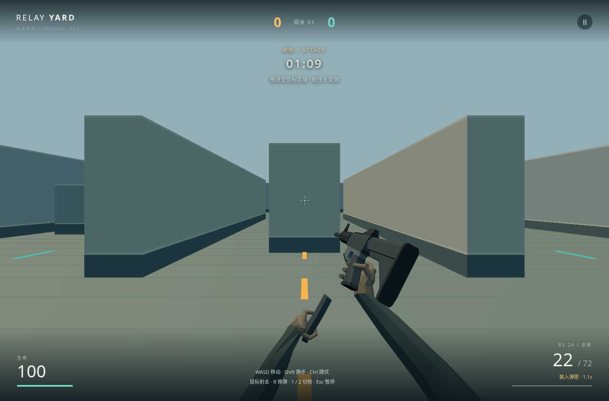
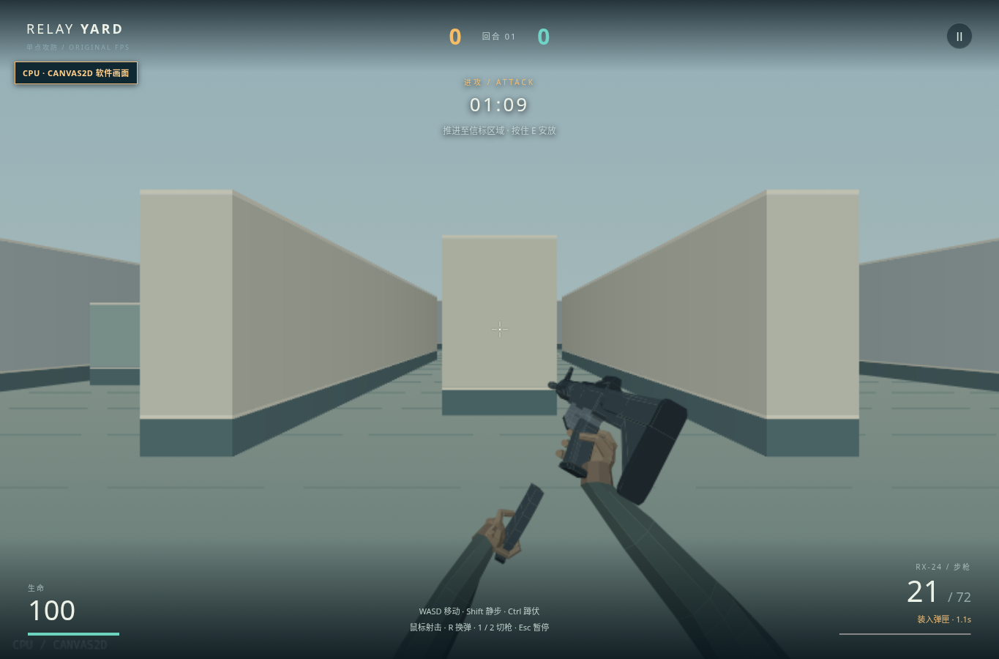

# 当前品质：换弹时的腕臂连接

原有枪、掌指和弹匣接触不变；双袖改为从画面外的身体端弯向手腕，不再随掌整体平移。退出、回插与回握更像同一条手臂的连续运动，低细节袖管与固定手指仍明显，未达到 CS2 动作品质。

## 当前画面

2026-10-26，代码 `cdebf5f`；正常鼠标连射后按 R，完整退出、回插和重新就绪。两后端独立实际运行；Three 为软件 WebGL2，不代表硬件 GPU。新旧并排图及原始连续录像只留本地。

## 参照与差距

主参照为 [Valve 的 CS2](https://store.steampowered.com/app/730/CounterStrike_2/)；[官方 2025-07-28 动画更新](https://store.steampowered.com/news/posts/?appids=730&enddate=1753835380&feed=steam_community_announcements)明确同时更新第一人称开火、换弹、取枪动作及相关声音。本轮未实际操作当前 CS2，更新文字不替代同输入动作或听感比较。

| 维度 | 当前结果与最大差距 |
|---|---|
| 连续连接 | 相机空间身体端稳定，肘向外弯，袖口跟随现有手腕；左腕仍有明显扭转折面，缺肌肉、布料与更自然的腕部转动。 |
| 接触与阶段 | 真弹匣的退出／回插与掌面接触保留，回握后再就绪；手指全程固定，同一弹匣沿原路径返回，尚非完整取新弹匣表演。 |
| 画面与控制 | 双袖留在画面下方，未改瞄准、后坐或换弹时间；枪手仍是低面数硬质造型，场景层次和亮天上的小字对比仍不足。 |
| 完整循环 | 本轮看到了连射、停止恢复、换弹与弹药就绪；没有实际听声音，受击姿态、移动停枪精度及 CS2 对照仍欠验证。 |

源资产与可编辑配方见 [武器说明](../assets/weapons/README.md)。

正常换弹的双后端原帧与连续录像经非作者复评，接收为减少整袖平移的有限改进，不是自然人体动画完成。
