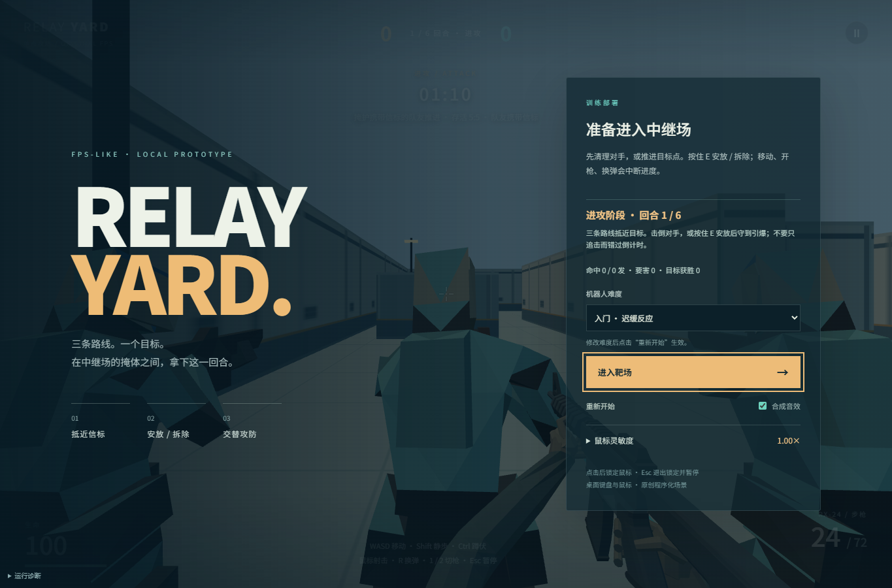
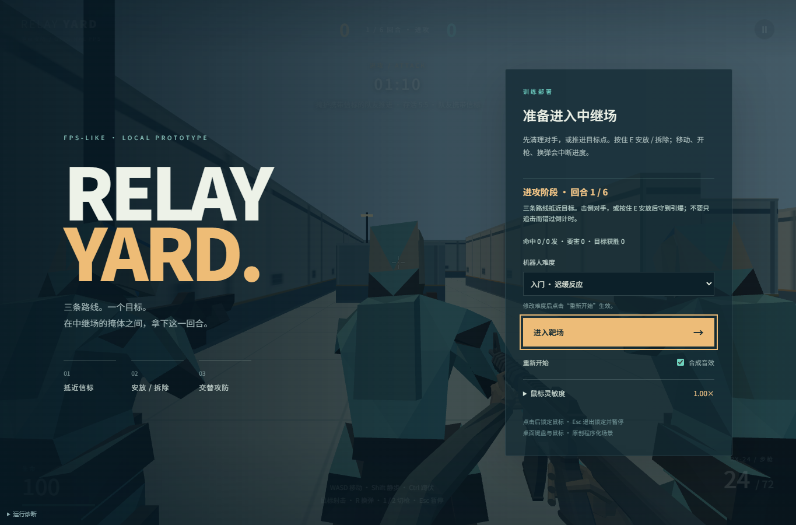
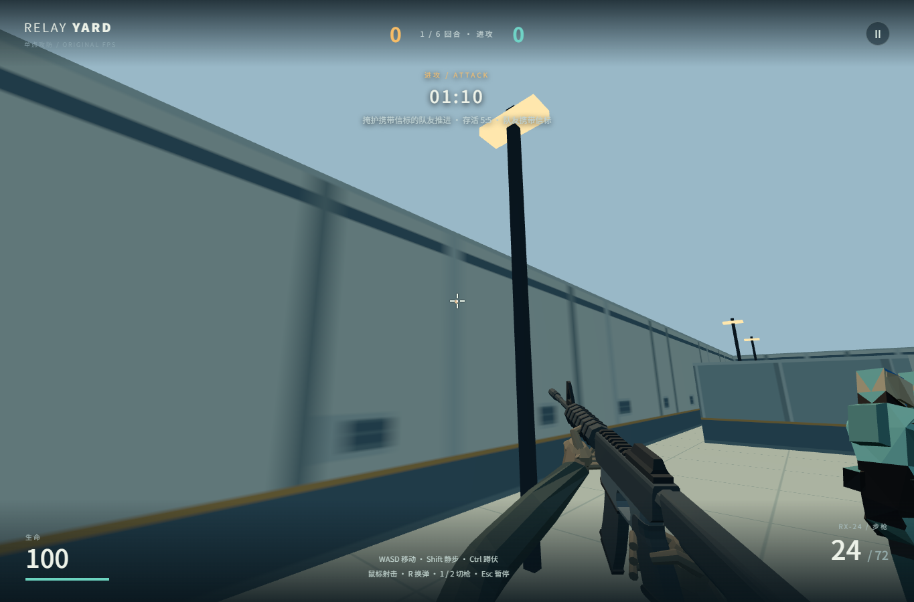
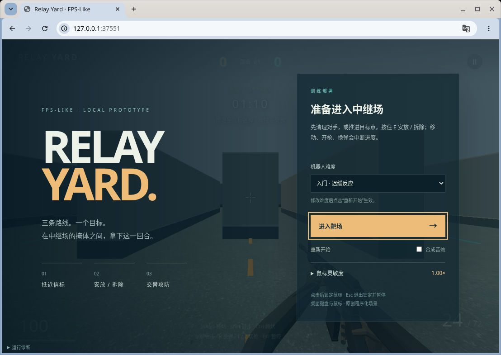

# 云端固定机位与灯光旁置（2026-10-29）

原始基线测量源为 `9aa2ee6`（基于已交付 `b6ecc`）：离线训练赛、完整比赛、九机器人、courtyard-v1 与 standards-v1；三个命名机位 seed 1 / tick 120 / idle / 1280×720 DPR 1 均已取得真实 WebGL2 软件图，两遍 RGBA 完全一致。gameplay 保留生产 HUD/枪械，另两图为固定 observer，不代表玩家可达性或手感证据。

两位独立非作者实际看过三图，临时文字锚点诊断均指向大面积重复墙面、地砖与箱体缺少场所身份，人物轮廓碎片化，接触与明暗层次弱。未取得 1–5 图像锚包及合格同机位目标，不填正式分、不称商业对标通过。后续布景层仍有明显缺口，本轮按用户决定先做完整灯光层。

courtyard-gap 原生生图目标先后两次均未通过独立几何复核：灯头、人物/武器、掩体边缘与地砖线被重绘。停止生成，只保留局部暖主光、冷暗部与色调参考；目标合格数仍为 0/3。图片留云端，未上传或收入 Git。

## 显式候选

在离线训练赛已有参数后追加 `lighting=courtyard-light-v1`，与 `feel=ground-v1` 可组合；缺省、未知及重复 lighting 值保持 baseline。可玩入口和固定机位共用 View。静态几何、材质贴图、物件位置、输入、物理、模拟与玩法不改。

实际受光路径是 MeshStandardMaterial；使用半球天空/地面补光加少量环境光，而不是仅挂 scene.environment。方向光投射 2048² PCF 阴影，ACES 曝光 1.05；半浮点世界颜色经过固定半分辨率、固定采样 SSAO 和轻微冷暗部/暖亮部调色，再由 OutputPass 输出。发光玩法提示及相机武器不进入世界 AO，保持自己的深度与材质路径；Basic 提示不受 ACES 影响，保持标记辨识度。阴影每帧只在世界颜色通道更新一次。异步资产及演员也参与世界投射/受影。只作为基础照明旁置，不声称已达目标或替换默认。

首版三机位各两遍 RGBA 一致，baseline 与 9aa2 原图逐像素一致；两位非作者盲选候选为可接受旁置，指出提示圈变淡、人物暗部和阴影边缘待打磨。首版生产默认有/无 feel 均过，照明+feel 在 180 秒窗口完成首轮 144 tick 与重开、第二轮仅 3 tick，因软件渲染成本超时；真实浏览器 exit 0、端口关闭。保留失败证据，本次半分辨率 AO、去除重复阴影更新、补暗部与保留提示颜色是针对性返工，半分辨率版本提高至第二轮 81 tick 仍超时，继续将不透明、无 alpha/displacement/clipping 的 Standard 世界材质深度重建改用等几何深度 shader，其他材质保留原 shader；截图尺寸及阴影尺寸不变。仍须完整复验，不把首版或下方历史记录当最终通过证据。

## 最终本地验证与旁置接收范围

实现验证源 `1826279776c4c537bf97a41842fdad0e4a86570f`（从 9aa2 测量接缝继续，未改静态资产、模拟或输入）。完整 CPU 356/356、生产构建和独立代码审查通过。三个命名机位 baseline/candidate 各两遍，共 12 张，1280×720 DPR 1、seed 1、tick 120；同机位状态、命令、相机与每版重复 RGBA 全部相同，baseline 六张与原 9aa2 图逐像素一致。

最终两位独立非作者实际看六张匿名对照，三个机位均选择照明候选，接受为旁置。箱体、人物、灯柱接地及方向性照明更明确，黄色目标圈已恢复鲜明，未见明显过曝或大范围 AO 光晕。人物腰部/装备暗面仍有黑块合并，cross-lane 人物投影边缘有颗粒与台阶；没有运动阴影稳定性结论。不能替换默认或宣称正式达标，合格目标仍为 0/3，锚图仍缺。

生产入口 baseline/lighting × 有/无 feel 四路均完成两轮各 144 tick 与真实重开：有 feel 每轮 `5ea95f2b`，无 feel 每轮 `2d7ad50c`，照明不改变模拟结果；非空 WebGL2、无页面错误。第三次 180 秒窗口仍只完成第二轮 120 tick，因此最后按实测软件帧成本将本轮照明功能测试等待窗口设为每路 300 秒，未减少 tick、重开或 hash 断言；180 秒性能窗口并未通过。普通实时玩法原有长帧保护保留，显式 smoke 固定步通过不证明软件渲染流畅或真人手感达标。

环境：Chromium 154.0.8037.57，raw renderer `ANGLE (Google, Vulkan 1.3.0 (SwiftShader Device (Subzero) (0x0000C0DE)), SwiftShader driver)`，分类 software。实际 MAX_SAMPLES/SAMPLES=4，最大各向异性16，compressedTextureFormatsSupported=[]；实际纹理内部格式未观测。候选 ACES、exposure 1.05、sRGB、PCFShadowMap 实际生效；2048² 阴影及固定半分辨率 AO 是实现配置。浏览器使用用户本轮特批 headless `--no-sandbox`，仅本地案例同源页，移除 unsafe SwiftShader 默认参数，外层隔离不变。功能 smoke 与固定机位两个浏览器均真实 exit 0，预览端口已关闭。所有图片和失败回执仅留云端，没有上传或收入 Git。

此单元仅交付候选分支，main/Site 由接收端另行决定。文档收尾提交不改运行代码，接收以 clean 构建全部 29 文件与上述实测产物逐 SHA-256 一致为准。

---

# 历史品质记分卡（保留原验收范围）

基线：main `83e7c0b4e2c026ded1906aa5be71601859482431` / Site v15（默认原1v1，离线训练赛与三件环境标准件旁置）。功能门槛已过不代表质量达标。标准按 a1dbv `f4b4e801` 的 game-quality-pass/quality-bar；首轮基线及 ground-v1 手感旁置候选。**品质对象锁定已交付的 v15 offline-training-v1 + complete-v1 + squads offline-v1 + courtyard-v1 + standards-v1；默认1v1和movement-v2仅作拆分诊断，不将旧图代表当前5v5。**

| 线 | 达标线 | 当前 | 最大差距 | 下一单元 |
|---|---|---|---|---|
| 画面 | 三命名机位各双非作者较低分≥4、目标图先过≥4、七层齐全 | gameplay/courtyard-gap/cross-lane 均待评分；合格目标0/3，当前main匹配GPU图0/3；旧gameplay图1张可作历史基线 | 目标与标杆同机位证据不齐；旧实图大素面墙、明暗/近远层次弱 | 接收既有observer拍摄结果，按机位做目标并双盲评，不另起GPU任务 |
| 手感 | 逐项±20%或有非作者认可偏离、三路同帧、录像对照只剩细节 | 原训练赛松键首tick零位移；ground-v1滑停350ms/0.612458单位、反向116.67ms；已接previous/current位置插值，十发100ms/换弹1.900s保留 | 候选运动和插值已CPU验证；起步566.67ms可能偏慢，缺可见反馈/标杆录像与非作者手感 | 接收候选功能smoke，再以同输入实拍核首反馈/起步；前后数值见[规格与实测](feel.md) |
| 内容 | 阶段完整清单每件同框标准件不掉档，100% | **0/77（0%）**标准件验收槽位；实现存在量另列，非作者类别核对待做 | 已接线不等于过标准件，角色动作/完整比赛内容有缺口 | 对已有场景/角色/枪与动作成套比对，不先扩新系统 |

## 命名机位与目标证据

现存命名机位源 `src/capture/cameras.ts`，它只调用旧1v1 Game；offline-training-v1启动优先于shot，不能组合参数假称拍到v15。需要最小测量适配将这些视角绑定训练赛真实Game与既有资源消费者，当前三处均未接入当前品质对象。1280×720、80°竖直FOV，均为本图几何定义，尚非标杆量取。1–5档锚定样图也未齐；无作者自评分或伪造双评。

| 机位 | 实际截图 | 目标/标杆/评分 | 保持构图的重绘要求 |
|---|---|---|---|
| gameplay | [历史GPU图](quality/smoke/B-FPS-BACKLOG-SMOKE-20261028/4b99b59a6b11-yP8eZD/screenshots/capture-seed1-tick60-r1__00000.png)：4b99b59、seed1/idle/tick60，RTX5070；当前main未重拍 | 同机位目标缺；商业本地标杆未找到；两评分待测 | 锁三路、中央折墙、墙轮廓、枪/HUD/眼高；暖主光冷暗部、浅墙青灰裙少量赭边，接触阴影和远近层次；禁止删折墙换布局 |
| courtyard-gap | 无已留存命名截图；(2.6,1.62,6.4)，yaw−0.28/pitch−0.04，不画枪 | 目标/本地标杆/两评分均缺 | 待实际图后锁近地面—分隔墙—点区—远墙关系，做三层明暗、地面材质族和墙根接触，不添加改变路线的物体 |
| cross-lane | 无已留存命名截图；(−7.5,1.62,−9.5)，yaw0.32/pitch−0.03，不画枪 | 目标/本地标杆/两评分均缺 | 待实际图后锁外墙与掩体边界，统一长材质交界、暖冷大面与远端焦点，不擅自移掩体 |

既有自制环境目标为历史另一状态，不是上述任一机位的合格目标；原PNG上传仍待原审批，不收入或换渠道重传。其墙体、HUD与枪械有重绘偏移，不能直接充当≥4门槛。商业参照仅给[Riot视觉清晰度说明](https://www.riotgames.com/en/news/valorant-shaders-and-gameplay-clarity)与[CS2](https://www.counter-strike.net/cs2)，本轮未取得本地同机位参考图/同操作录像。菜单部署图不能替代无遮挡正常游玩机位。排队observer候选不在此基线中，未重复或更动。

七层状态：灯光已有Hemisphere/Directional与雾，但无投射阴影/后处理；空间仍大素面墙；地面有纹理不是全平涂，墙材质层次不足；角色为程序体或刚性GLB旁置，缺动作细节；布景有6灯及边界收边；反馈与程序音有事件但未音画同帧验收；HUD可用但尚无非作者净空/层级评分。七层均未整体品质通过。

## 当前阶段完整内容清单与分母

阶段取 brief A 核心回合 + 已进入的B离线完整比赛目标；不是只统计v15三件。按**可独立验收的内容槽位**计数，重复实例不重复计算：十名战斗角色是角色套件实例，墙/灯因不同摆放需同框核验分别计。每个动作与声音按语义类计，武器差异在该槽位验收内检查；若增加类型/动作必须扩分母，不静默减少范围。B尚未规定的扩展枪库和C不提前计。音乐暂保留1项（需非作者确认可由无音乐设计替代），敌对中立单位数量0是brief无此类，而非漏列。此77是当前最小完整清单，不是77个都已实现。全部“通过”必须有非作者同框证据；目前**已通过件数0**，三件ready/active也不算3分。

| 内容槽位（括号为数量） | 当前实际存在/缺口 | 标准件通过 |
|---|---|---|
| 角色外观：敌我两套(2) | 两队配色/程序角色；characters-v1有1敌人GLB，训练赛不兼容此候选 | 0/2 |
| 第三人称动作：idle/run/crouch/fire/hit/death/reload/switch(8) | 训练赛：idle为静态持枪姿态，无呼吸；run仅整身位移/yaw，无步态；crouch仅整身高度缩放；hit为整身flinch，death为整身fall；fire/reload/switch无专用第三人称动作。characters-v1刚性动作不兼容训练赛，不能计入此对象 | 0/8 |
| 武器：步枪/手枪(2) | 2玩法类别；1第一人称步枪GLB候选，手枪程序体 | 0/2 |
| 第一人称动作：idle/move/fire/reload-out/reload-in/bolt/switch(7) | 训练赛：idle为静态持枪，无呼吸；move有输入驱动sway；fire有kick/flash；reload-out/in有弹匣与支撑手分段位移；bolt有闭锁件位移；switch仅切换武器可见性，无切枪过渡。指部接触与动作质量待核 | 0/7 |
| 地图整体与三路线（含天空/光照/远景）(1) | 1单点小图，已有天空底色、半球光/方向光与雾；远景层次及整层品质未验，B双点地图缺 | 0/1 |
| 墙/掩体摆放 west/east/south/north/left-divider/right-divider/west-cover/east-cover/center-dogleg/site-cover(10) | MAP.walls实际10；其中折墙/低掩体2件旁置GLB | 0/10 |
| 灯位(6) | 6原灯，1替换标准GLB，5原样 | 0/6 |
| 地表材质族(1) | 1混凝土地面及庭院程序层 | 0/1 |
| 点区/炸弹(2) | 单点标记与炸弹交互；B第二点未有 | 0/2 |
| 战斗特效：枪口/轨迹或落点/普通命中/爆头/死亡/受击(6) | 有程序反馈路径，跨武器/敌我可读性未审 | 0/6 |
| 声音：步枪/手枪/退匣/入匣/闭锁/脚步/命中/爆头/击杀/安放/拆弹/炸弹预警/爆炸/受伤/切枪/菜单操作/回合结果(17) | synth/audio为可编辑源；前10语义声部存在；后7缺专用cue或待确认，不按存在通过 | 0/17 |
| 音乐/场景音景(1) | 无独立音乐资源；静默设计与威胁声优先级未验 | 0/1 |
| UI：部署/战斗HUD/暂停/设置/购买装备/回合结算/整场结算/重开(8) | 除购买装备外7类有界面路径；整场六回合/换边/终局尚未完整实玩 | 0/8 |
| 技能：烟幕/侦察（各含第一/第三人称施放动作及声音）(2) | 0套：玩法、第一/第三人称施放动作、施放/生效/消退声音均缺；brief B目标明确，不以无实现剔出分母 | 0/2 |
| 技能施放/生效/消退特效套件(2) | 0套 | 0/2 |
| 代表性投掷物套件(1) | 0套；B未明确数量，最低1槽，定型后扩分母 | 0/1 |
| 经济/装备购买内容套件(1) | 0套 | 0/1 |
| **合计** | **77验收槽位；类别齐全性与槽位粒度待非作者核对** | **0/77** |

动作核查依据：训练赛 [`target.ts`](../src/candidates/offline-training-v1/render/target.ts) 的 targetVertices 仅应用位置/yaw、蹲缩放和传入角度；[`scene.ts`](../src/candidates/offline-training-v1/render/scene.ts) 角色渲染只传 fall−flinch，不消费射手fire为第三人称动作。第一人称 [`weapon.ts`](../src/candidates/offline-training-v1/render/weapon.ts) weaponPose/weaponPartPosition 提供sway、kick与分段换弹，scene仅以visible切换枪型。静态姿态、刚体变换和完整角色动作不混计。

套件验收边界：地图整体槽包含天空、光照和远景，不另以资源文件数重复计；烟幕与侦察各自的技能槽必须同时验玩法、第一/第三人称施放动作、施放/生效/消退声音，视觉特效仍在其独立槽验收。17个战斗/界面声音槽不包含技能声；技能声按对应技能套件条件核验。套件内任一必要部分缺失则整槽不通过，语义归类不表示已经实现，也不改变当前0/77。

前述清单是完整性审计，不作为本轮新增玩法授权。优先提升现有核心片段的整层品质；有意义二改与同框标准件评价未做，不将素材文件数量等同内容完成率。

---

# 当前品质：v15 三件环境标准件旁置入口

中心折墙、场地低掩体和一盏既有灯现在有可编辑的规则建模版本，配合浅墙、青灰墙裙和少量黄赭收边；其余五灯、地图、碰撞、灯光、角色、HUD与玩法保留原样。候选入口是在 v14 离线训练赛参数后追加 `&art=standards-v1`；资源失败保留原几何。**网站 v15 已于 2026-10-29 01:19:53 UTC 发布该旁置入口，默认入口保留。** 案例接收提交 `a14a6b521629bd29ca1e576f8dba01a3680c5201`，Site 源提交 `d3c6160e1b7d892fe45315d99c306b13e39d2a3b`；21 个上线静态文件与被测构建逐 SHA-256 一致。

固定实现源 `9a5c02fc6b51c852d567cc0d4d28bf388fc41f4b` 的第二次执行，在 RTX 5070 / D3D11、保留 sandbox 的 headless Chromium 下，两路均完成首个自然回合、下一回合及整场重开等功能 smoke；三件显示为 ready/active，资源几何为 2,396 三角面、4 个 mesh draw、123,604 字节。这是资源计数，不是整场 GPU 性能测量。CPU 332 项检查已通过，21 个被测构建文件有固定 SHA-256。[原回执](quality/smoke/B-FPS-ART-STANDARDS-SMOKE-20261029/9a5c02fc6b51-eDgeRr/manifest.json)保留原样。

## 当前前后画面与目标

以下两张是同一构建的初始部署机位，tick 0、同一玩家眼位／朝向，每路重复两张像素一致。菜单和 HUD 遮挡大部分场景，前后仅约 0.84% 像素不同；非作者结论为“可见区域未见明显退步，菜单遮挡导致不可判优；不是已判不更好”。不能据此判定标准件更好，也不能代表正常战斗机位。

自制 AI 目标草图已经保存在独立工程草稿中，但该图片的 GitHub 上传仍待审批，故本次未收入仓库，也没有通过其他格式或渠道重传。目标图缺口保留，品质不结项。

目标草图重绘了部分 HUD、枪械及物体边界，仅取浅墙、青灰基座和安静的大材质层次；未把图烘焙进模型。专业方向参照为 [Riot 的着色与玩法清晰度说明](https://www.riotgames.com/en/news/valorant-shaders-and-gameplay-clarity)，没有复制商业游戏资产。

## 尚缺的证据

- 墙面／墙角在正常眼位下的轮廓、贴墙碰撞感，低掩体视线、灯具与敌我角色同框的可读性，真实战斗机位均未完成对照。初始部署图不代替这些。
- 非作者仅完成上述可见区域判断，未判优；未完成有意义的第二次美术修改；相同参数重建不算二改。完整六回合、换边、终局再玩、真人视听手感及运行性能仍未验。
- **历史说明已限定接收，执行违背仍保留**：第一次软件渲染失败后更换浏览器重跑，违背原卡停止边界。历史修订恢复首次 run-id 与 manifest，但首轮完整 report／raw WebGL／浏览器日志未留存，预览端口关闭及完整父链退出未知，第二次启动前末段缺采样。接收只覆盖纠正文案、已留存事实及第二轮功能证据，不宣告首次执行合规、全局 GPU 独占或品质通过。[接收审查范围](quality/reviews/art-standards-20261029.md)。

---

# 已上线 v14：离线训练赛旁置入口

2026-10-28，离线训练赛已随 `main` 的 `1125fc4` 发布到公开网站 v14，运行源 `19f718ebd5570ed1fb962b30d4ee607dc1ec9f6f`；默认入口与 v13 原四入口保持不变。

- [离线训练赛试玩](https://dbvv1-fps-like.pretty-llama-9945.chatgpt.site/?gameplay=offline-training-v1&match=complete-v1&squads=offline-v1&environment=courtyard-v1)：1 人＋9 个机器人、十名角色、六回合 HUD；不包含 characters-v1 或 movement-v2，`contentSet`／`shot` 组合明确拒绝。
- 复用已通过的 323 项 CPU 测试；新入口在保留 sandbox 的真实 GPU WebGL2 下完成移动、瞄准、射击、换弹中断、暂停恢复，首个自然回合结束后点下一回合，再用 UI 重开清空全场比分与记录。网站 19 个静态文件与被测构建逐 SHA-256 一致。
- 未实玩完整六回合、半场换边、终局及终局“再打一场”；画面、手感与声音未完成人工验收。接收端使用 Node 22，未在要求的 Node 24+ 重跑。详见 [页面报告](quality/smoke/B-FPS-OFFLINE-SMOKE-20261028/19f718ebd557-E2mXmf/report.json)与[范围及构建清单](quality/smoke/B-FPS-OFFLINE-SMOKE-20261028/19f718ebd557-E2mXmf/manifest.json)。

画面仍粗糙：大面积平直墙面、硬质低细节人物与袖臂仍明显；该截图不是同机位品质对照，不据此声称比原版本更好。

## v13 已有旁置：角色内容与移动候选

2026-10-28，旁置版本已合入 `main`（`777e830`），发布到公开网站 v13；运行源为 `4b99b59a6b111c61d4aebd6e659bfb851e9eb736`。默认入口仍使用原来的 1v1 操作与规则，不启用移动或角色内容开关。

- [默认试玩](https://dbvv1-fps-like.pretty-llama-9945.chatgpt.site/)；[组合旁置试玩](https://dbvv1-fps-like.pretty-llama-9945.chatgpt.site/?gameplay=movement-v2&contentSet=characters-v1)。单独开关见 [README](../README.md#旁置试玩)。
- 角色入口接入成套角色、第一人称武器与动作资源；移动入口加入加速、松键制动、反向急停和持续后坐力。拍摄入口用于固定状态复拍，不替代正常游玩。
- 同一运行源的 197 项测试、类型检查和生产构建通过；默认、角色、移动、组合四入口的真实 GPU 无头 smoke，以及 capture 两次逐帧一致性检查通过。Site 的 14 个静态文件与被测构建逐 SHA-256 相同。
- 画面、灯光与手感盲判尚未完成；功能 smoke 和截图不证明品质达标或优于旧版，不据此切换默认入口。

v13 的结果与运行限制见 [当轮 smoke 报告](quality/smoke/B-FPS-BACKLOG-SMOKE-20261028/4b99b59a6b11-yP8eZD/report.md)（报告是发布前的固定回执，其中“未合 main、未部署”描述回执生成时刻；当前发布状态以上文为准）。该回执运行于 Node 22，要求的 Node 24+ 未在接收端重跑。

## 已有默认入口：暂停菜单与连续射击

以下为 2026-10-27 默认入口的既有观察，不是新旁置版本的品质验收。

暂停菜单现在不会把键盘焦点送到背后的游戏控件；设置草稿可先取消，再回到主按钮继续。自动射击按已处理的按下/松开时间线消费输入，避免低帧率在松开后补算时吞掉本应发出的尾发。地面保留已发布的混凝土版本，本轮不改场景资产或武器数值。

2026-10-27，运行源 `a8f5be80ea4e4ab948da73ff1bd81fb44f98aa59`。主要参照仍为 [Valve 的 CS2](https://store.steampowered.com/app/730/CounterStrike_2/)；本轮没有实际操作当前 CS2，不把浏览器处理时刻当硬件输入时间戳，也不宣称等价 subtick。

| 维度 | 本轮结果与边界 |
|---|---|
| 暂停与设置 | 正常 Tab/反向 Tab 不落入背景画布或暂停按钮；草稿阻止开局，Esc 先取消并收起设置，再回主按钮。有效菜单焦点保留；浏览器自身工具栏仍可获得焦点，不把浏览器 chrome 当游戏可约束的区域。失败提示会释放模态层，不被覆盖。 |
| 连续射击 | 相同 CPU 处理时间线在 60/30/20 Hz 下保留合法尾发，提前松开的反例仍不发；不提高射速。当前正常 Three 与 CPU 各三次实际 117–131 ms 短按均消耗 2 发，365–372 ms 连射均消耗 4 发。实际发数依据弹药差及完整 CPU 时间线，而非逐渲染帧日志。 |
| 边界闭环 | 两后端正常换弹中切枪、半自动长按仅 1 发、按住时 Esc、恢复无幽灵枪、重开恢复弹药均通过。暂停、失锁、设置与重开继续清理历史输入。未加入依赖另一载入实现的异步重开取消补丁。 |
| 实际观察 | 原生有窗口 Chromium 155、保留 sandbox 的软件 WebGL2 与独立 Canvas2D 均完成短路线；无连续录像、不调用页面截图，另用原生整窗观察。没有改状态、时钟或发合成游戏输入。此轮没有进行声音听验、真人手感或硬件性能测量。 |

## 尚未验收的整体差距

旧版观察的主要差距是院落整体结构、比例与材料层次，以及固定手指、僵硬敌人姿态、急停点射的人体手感与声音。旁置资源与移动实现已经上线，但这些差距是否改善，仍需同机位对照和真人手感判断；当前不作改善结论。

2026-10-27 版只合入已审菜单与输入，保留原地面和实时渲染；木箱/新静态光照整合未进入本版。该组合此前的页面崩溃证据仍保留；本次无录像条件下通过，不能反推旧崩溃由录屏或任何单一原因造成。

上述旧版的 85 项串行测试、生产构建/类型检查、无画面 smoke 与普通 UI 路线通过记录，仅对应当时版本；当前旁置版的功能验证见本页开头。
