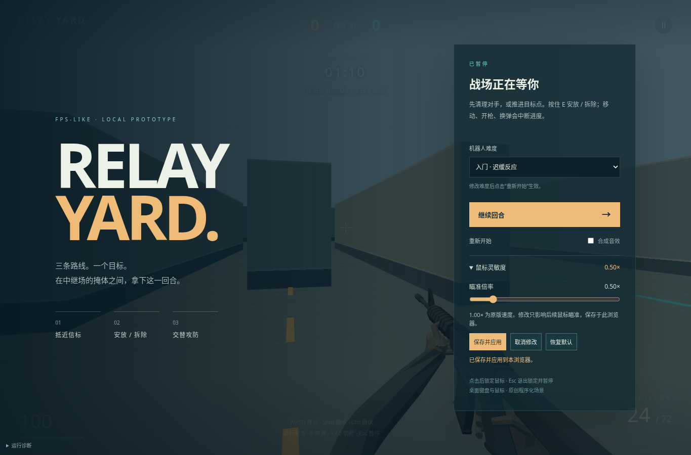
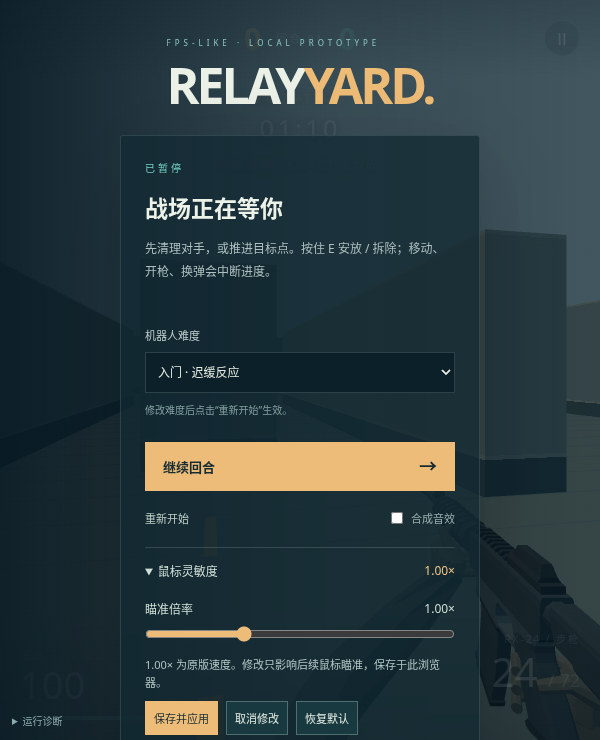

# 当前品质：可保存的鼠标灵敏度

暂停菜单现在能调整瞄准倍率、保存、取消修改和恢复原值。默认 1.00× 保留原版转向；调整后再继续开火与换弹，不需要重新开始回合。

## 当前画面

2026-10-26，代码 `ce243cd`。正常键鼠操作完成保存后重载、取消、恢复默认、再进入游戏和开枪换弹；Three 软件 WebGL2 与 Canvas2D 分别运行。新旧同输入画面对照只留本地，未测试硬件 GPU 或触屏玩法。

## 参照与差距

主品质参照为 [Valve 的 CS2](https://store.steampowered.com/app/730/CounterStrike_2/)。本轮没有实际操作当前 CS2，不能把倍率或转角与其设置数字等同；[浏览器鼠标位移单位也存在平台差异](https://developer.mozilla.org/en-US/docs/Web/API/MouseEvent/movementX)。

| 维度 | 当前结果与最大差距 |
|---|---|
| 调整与回到游戏 | 当前值与未应用草稿分开；保存或取消后继续。未应用时不会在菜单背后移动、开枪或自动开始回合。倍率只能选 0.10–3.00×、步进 0.05，尚无独立瞄准镜倍率或按键重绑定。 |
| 保存与恢复 | 同浏览器重载保留设置，恢复默认只清除自己的覆盖值。保存失败保留原运行值并提示重试，不假报成功；[浏览器存储受站点与策略限制](https://developer.mozilla.org/en-US/docs/Web/API/Window/localStorage)，不提供跨设备同步。 |
| 实际瞄准 | 同一 100 单位水平鼠标输入，1.00×、0.50×、2.00×及恢复默认分别转向 0.20、0.10、0.40、0.20 弧度；低倍率画面扫过更小范围。这个闭环不证明真人追踪、急停点射或长时间舒适度，仍需实际手感比较。 |
| 完整射击循环 | 调整后仍能移动、射击、换弹并暂停；未改弹道、后坐恢复、伤害或原手臂动作。手指固定、腕部折面、目标静态姿态和灰盒场景仍是主要可见差距，声音尚未完成真实听验。 |

这是输入可调性改善，不是 CS2 射击品质完成。
