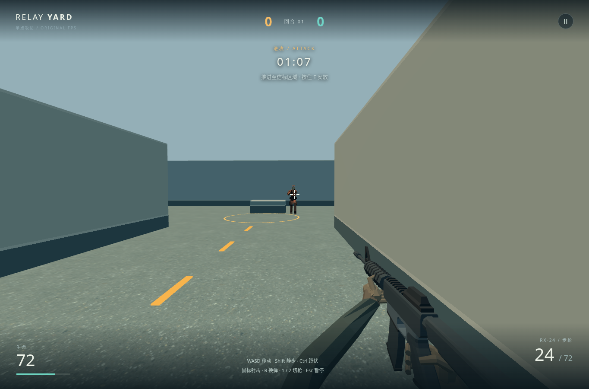
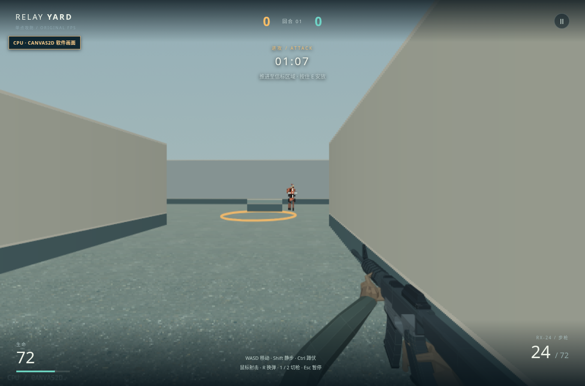

# 当前品质：庭院混凝土地面

单个庭院的地面由调试网格改为细骨料混凝土。候选只改变表面颜色，保持墙体、低掩体、碰撞、路线、目标和原照明；材料来自 [Poly Haven / Rob Tuytel 的 CC0 Concrete Floor 01](https://polyhaven.com/a/concrete_floor_01)，[原件与可重建配方](../assets/materials/courtyard-concrete/README.md)随源提供。

## 当前画面

2026-10-26，Three 为 `05b7710`；CPU 图来自 `d9efd47`，最终版只改变 Three 的各向异性值，CPU 字节不变。两后端均以正常键鼠完成接敌、射击、命中和倒下片段。新旧并排图只留本地；同路线输入的截图位置略有差别，不用于比较命中率。

## 参照与差距

主参照是 [Valve CS2 官方展示](https://www.counter-strike.net/cs2)，本轮观察其 [Nuke 庭院画面](https://cdn.fastly.steamstatic.com/apps/csgo/images/csgo_react/cs2/maps/nuke_t_s2.jpg)的工业表面尺度、地面与建筑层次，没有实际操作当前 CS2，也未使用其资产。

| 维度 | 当前结果与剩余差距 |
|---|---|
| 表面与读图 | 近处由调试线变为可辨细骨料；道路标记、目标环、敌人头胸及低掩体边缘仍清楚。不是完整的磨损、接缝与建筑材质层次；远墙仍是灰盒。 |
| 双后端 | 同一颜色源按 2 米尺度铺设，CPU 保持原墙/人物遮挡。CPU 近处略颗粒，远处变平；Three 降低各向异性后斜视也更模糊，未采用法线、位移或额外阴影。 |
| 成本 | 固定热态菜单、无录像的基线→候选→基线各 120 个 rAF 间隔：中位数 50.0→50.0→49.95ms，p95 66.7→50.1→50.1ms。未复现早期含录像短样本的明显菜单退化，但短软件渲染样本不证明硬件或长期预算；候选增加一张纹理与约 197KB gzip 客户端体积。 |
| 完整射击循环 | 未改模拟、弹道、伤害、输入和换弹；手指固定、腕部折面、对手静态姿态仍存在，声音尚未完成真实听验。此轮只改善庭院表面辨识，不代表 CS2 品质已达成。 |
